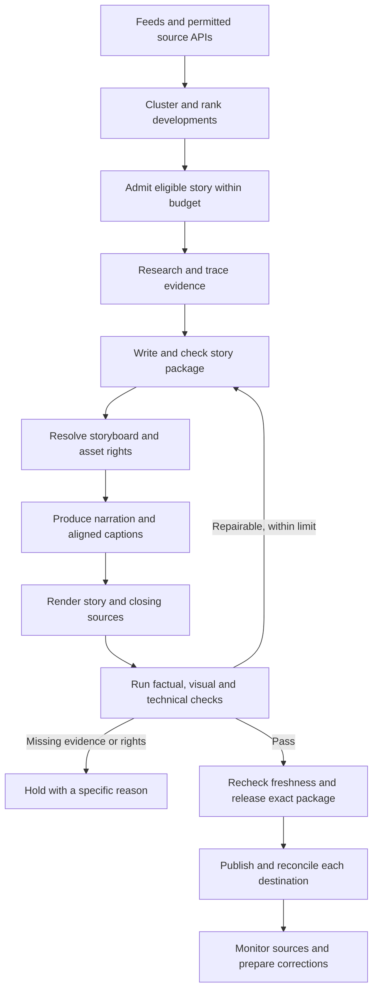

# World News: automation and video quality execution plan

Prepared 2 November 2026. This is an investigation and implementation plan, not a claim that the proposed features are already built. Existing work in the checkout was inspected without changing application logic, live settings, stories, or publishing state.

## 1. Recommendation

Keep the current application, evidence records, job queue, narration cache, and shot timeline. Turn them into a production system built around a verified story package: evidence, script, visual treatment, licensed assets, narration, captions, complete citations, and a release report belonging to the same revision.

The largest gaps are story construction, visual relevance, complete closing citations, and production orchestration. Replacing the language model or installing another video generator alone will not solve them.

The intended outcome is automatic discovery through publication for eligible stories, with automatic holds when evidence, visual context, rights, or quality cannot be established. Automation must be able to decide that a story is unsuitable. It must never manufacture context or stretch a weak story merely to meet a runtime or posting quota.

“Factual” is an editorial objective supported by evidence checks and evaluation; no model or unattended workflow can guarantee that every real-world assertion is true. I recommend automatic release for a defined, evaluated set of lower-risk stories, and an exception queue for consequential disputed reporting. That is a proposed operating policy, not an existing technical limitation that must apply forever.

## 2. Investigation and verified baseline

Inspected the current working tree, including uncommitted renderer changes, rather than only the README. Read the discovery, research, evidence gates, drafting, media discovery, compositor, worker, source-page, publishing, and dashboard code. Read current saved story records and render manifests through a read-only database connection. Measured the latest saved videos using ffprobe and inspected extracted frames from the Binance and Poland previews.

Validation on this checkout: **94 tests passed, zero failed, two PostgreSQL integration checks skipped; production build passed.** Provider tests are largely mocked. This does not establish factual accuracy, real publishing capability, or performance under unattended load. No new paid provider calls were made for this investigation.

### Latest saved exports

| Saved dossier | Words | Measured final video | Current treatment | Finding |
|---|---:|---:|---|---|
| Poland tribunal, v16 | 62 | 32.33 s | MoneyPrinterTurbo, Gemini, 24 fps | Fails the requested one-minute minimum |
| Binance, v18 | 85 | 44.33 s | MoneyPrinterTurbo, Gemini, 24 fps | Fails the minimum; substantial text-card time |
| India protest, v8 | 62 | 27.96 s | MoneyPrinterTurbo, Gemini, 24 fps | Fails the minimum; relies on one attributed outlet |
| Youth-led rallies, v3 | 153 | 72.00 s | Classic, local voice | Meets runtime, uses the older scene compositor |
| NASA examples | 149 / 164 | 60.69 / 74.25 s | Older exports, 12 fps | Historical pipeline samples, not current-news quality proof |

These are measurements of private artifacts, not independent verification of the reporting contained in them.

The Binance timeline contains approximately **17.79 seconds of media, 17.71 seconds of report text, and 8.83 seconds of source graphics**. Only about 40% of the video is classified as media. Poland contains 18.50 seconds of media, 9.25 seconds of report text, and 4.58 seconds of sources. A media classification alone does not prove that a visual illustrates the exact spoken clause.

### Concrete gaps

| Priority | Finding | Why it matters | Main implementation locations |
|---|---|---|---|
| P0 | `brief` accepts 60 narration words and 20-second audio | Short videos are permitted deliberately; this is not an isolated rendering error | `server/domain.ts`, `server/providers.ts`, `server/automation.ts`, both renderers, tests |
| P0 | Automatic scripting copies eligible findings, capped at six segments / 185 words | A list of findings does not reliably create a coherent minute-long explanation or research missing context | `server/automation.ts`, `server/research.ts`, `server/providers.ts` |
| P0 | Exact passages and claim references do not establish that every sentence follows from the evidence | Titles, summaries, overlays, translations, and narration can introduce stronger or different assertions | `server/domain.ts`, drafting and research validation |
| P0 | Closing sources are selected from the final segment, deduplicated by publisher, capped at four | The Binance video uses seven supporting source records across narration, but the last card lists two; the FBI is absent from that final card | `server/editorial-plan.ts`, `server/editorial-art.ts` |
| P0 | Source-page visual credits select segment assets only | Assets used exclusively through the newer shot timeline can be absent from the source page | `server/source-page.ts` |
| P0 | Publisher media is stored with reuse permission unconfirmed | Visible credit and an accessible video file are insufficient release criteria; no unattended licensing workflow exists | `server/source-media.ts`, media gates |
| P1 | Shot kinds are partly chosen by index, including every-third-shot text and repeated sources | Cadence is implemented, but the visual argument is weak and repetitive | `server/editorial-plan.ts` |
| P1 | Portrait name matching and token overlap are limited contextual checks | Relevant-to-the-story media can still be wrong for the sentence, event, location, or date | media discovery and shot planning |
| P1 | Footage can be a small video inside another frame with existing captions and graphics | The Binance filmstrip shows competing caption layers and substantial unused screen area | `server/editorial-art.ts`, compositor bridge, asset selection |
| P1 | Automatic jobs default to local speech and estimated captions | The better paid voice and alignment path exists but is not a durable unattended production profile | `server/automation.ts`, workers, provider configuration |
| P1 | Feed polling already exists, but lead admission into production is manual | Discovery is automated only up to the shortlist | `server/discovery.ts`, `server/app.ts` |
| P1 | Approval is export-only; there are no platform publishers | “Approved” cannot be treated as “published” | `server/app.ts`, `shared/types.ts`, future adapters |
| P1 | Source rechecks and corrections are manual | A story can become stale while queued or after release | source recheck route, future monitoring worker |
| P1 | The ledger is a cumulative pilot allowance | It lacks the recurring operating budgets and retry reconciliation needed for continuous production | `server/db.ts`, providers, operations |
| P2 | Documentation disagrees with current code and artifacts | Some documents still describe absent feed/video discovery, old test counts, or universal 60–90-second output | README and existing docs |

Useful foundations already present: exact evidence snapshots, source hashes, lineage fields, contradiction holds, translation fields, revision invalidation, durable research/render jobs, expiring leases, budget reservations, bounded retrieval, source-media provenance, word-aligned captions, 3–6-second shots, reusable narration/shot caches, historical exports, and correction records.

## 3. BBC, CNN, and DW reference inspection

I visually spot-checked six official YouTube Shorts in the browser, two per publisher. The browser displayed playback, captions, and visual frames; text-only web retrieval of individual Shorts was throttled. This was a targeted visual sample, not a complete acoustic, frame-by-frame, retention, or factual audit. Observations below should not be generalized to every video on those channels.

| Reference | Observed treatment | What World News should adopt |
|---|---|---|
| [BBC: What are the US midterms?](https://www.youtube.com/shorts/s-JKw87NNZQ) | Reporter in a real location, explanatory imagery/graphics, compact captions, visible posting date | A clear question, a visual explanation, identifiable time context |
| [BBC: Binance hack explainer](https://www.youtube.com/shorts/VexujzaddZk) | Presenter occupies the portrait frame; short caption phrases; restrained branding/date | A clear lead, focused framing, less simultaneous text |
| [CNN: How could Democrats win the Senate?](https://www.youtube.com/shorts/ZIfmooqFJEM) | Correspondent explains a large electoral map; the map is part of the argument | Graphics that explain the mechanism rather than repeat narration |
| [CNN: Kidnapped girl rescued, authorities say](https://www.youtube.com/shorts/6bV7RfkBW8E) | Real footage, including courtroom material, with compact subtitles and source identification | Relevant footage, precise attribution, purposeful sequencing |
| [DW: Supermarket freezers and suspected cyberattacks](https://www.youtube.com/shorts/k0LxFqV-Bak) | Interview in a supermarket, translated subtitles, visible source microphone and DW identity | Real-world setting, attributed witnesses, careful translation |
| [DW: How costly could war be for China?](https://www.youtube.com/shorts/hExPp4fUMpQ) | Framed expert interview on a controlled background, compact subtitles | Qualified attributed analysis, a focused question, readable portrait treatment |

My interpretation: quality comes from choosing the right visual and information for each beat. It does not require a cut every three seconds. A sustained map explanation or relevant interview can work better than unnecessary visual changes. Use 3–6 seconds as a default planning range, with longer purposeful document, data, and interview shots when readability requires it.

An automated narrator-led channel can adopt this clarity and production discipline. It cannot recreate these publishers’ original reporting networks or interviews simply by using their appearance as a template. An artificial presenter should not be the first investment; evidence, footage access, writing, maps, and sound matter more.

The requested complete source ending is our own explicit product requirement. This sample does not establish that all three publishers routinely provide one.

## 4. Proposed output contract

| Requirement | Proposed release rule |
|---|---|
| Runtime | At least **60 seconds of substantive story content**, excluding opening logos, silence, and credits. Aim for 75–100 seconds total. Narration normally 60–90 seconds, followed by roughly 8–12 seconds of closing references. Permit longer credits when necessary rather than dropping references. Configure the final upper bound per destination. |
| Script length | Start around 140–200 English words at a natural pace; measured speech and meaningful content decide compliance. Existing previews demonstrate why word counts alone are insufficient. |
| Visual coverage | Every narration beat has a deliberate visual purpose. Initial target: at least 90% of narrative time uses relevant footage/photos, document highlights, maps, timelines, charts, or explanatory diagrams. Full-screen prose occupies at most 10%; the closing references are measured separately. |
| Relevance | Every selected visual declares the claim/clause it illustrates and whether it is direct evidence, archive, or context. Context imagery must not imply it depicts the current event. |
| Format | 1080×1920 master, consistent 24 or 30 fps, clean narration, burned-in captions plus downloadable captions; validate destination-specific exports. |
| Captions | Speech-aligned, maximum two readable lines, tested on a phone; names and numbers checked against raw recognition and evidence. |
| Closing sources | All reporting sources actually used by the released package, with publisher, short document/report title, date, and a readable version-specific source-page address. Paginate instead of silently truncating. |
| Visual credits | Required creator/agency attribution in the relevant shot and complete asset/license records on the source page. Long license obligations must still be satisfied. |
| Factual coverage | Every factual assertion in narration, title, thumbnail, on-screen text, chart, description, and closing summary maps to supporting evidence. |
| Publication | Exact checked revision and file hash only; current sources, valid rights, functioning public citations, and passing quality report required. |

A reasonable 80-second template is: 0–3 hook over a meaningful visual; 3–15 confirmed development; 15–33 how/where; 33–51 relevant background; 51–63 significance; 63–72 what remains unknown or happens next; 72–80 sources. The script should move those boundaries to fit the reporting.

No silence, repeated sentences, excessive slow motion, oversized credit sequences, or unnatural speech slowdown to turn a short item into a one-minute story. When material is thin, research useful background, combine genuinely connected developments, or hold the story.

## 5. Factual reporting workflow

1. **Identify the event.** Record entities, location, actual event time, publication/update times, and the specific new development. Resolve historical/current-event confusion before writing.
2. **Build an evidence packet.** Retrieve original documents or statements where available, independent reporting, and relevant competing accounts. Add PDF support and passage coordinates for reports currently left as unreadable leads. Store exact passages, hashes, retrieval times, language, and translations.
3. **Trace independence.** Model source relationships explicitly: original statement, wire report, syndication, quotation, and independent observation. Several domains quoting one announcement are not several confirmations. Unknown lineage stays unknown.
4. **Separate facts from statements.** An institution’s announcement establishes that it made the announcement. Allegations within it retain attribution. Corroborate central underlying assertions, or state clearly what is unverified. Apply the same discipline to experts and witnesses.
5. **Find missing explanation.** Ask what the viewer needs to understand the development: location, mechanism, relevant prior event, scale, consequence, response, and uncertainty. Research only missing, useful beats, within bounded rounds and cost.
6. **Write an original structured script.** Produce a hook, development, explanation, context, consequence, and close from eligible evidence. Preserve claim IDs at clause level. Prefer bounded synthesis to the current extractive list; copying findings remains a diagnostic fallback, not the production writer.
7. **Check the whole package independently.** Compare names, numbers, units, currencies, dates/time zones, direct quotations, translations, causal statements, and attribution against evidence. A separate semantic checker flags unsupported inferences. It does not certify truth. Validate primary-source attribution explicitly as well as outlet attribution.
8. **Measure narration.** If substantive speech is under 60 seconds, return to the missing-beat researcher/writer. Permit at most two bounded repair cycles by default, with a separate budget. If useful supported content is still insufficient, hold.
9. **Recheck before release.** Refresh active authoritative sources and material corroboration within a category-specific freshness window. Proposed starting windows: 15 minutes for fast-changing stories, 60 minutes for ordinary current affairs, 24 hours for stable explainers. Inaccessibility or a material change triggers revalidation or a hold. These are operating defaults to evaluate, not guarantees that a source stays correct within the window.
10. **Monitor after release.** Watch the core sources for material changes, determine which published assertions are affected, prepare corrections, and preserve the old evidence and correction history.

Use a benchmark set with deliberately misleading fixtures: an authentic passage that does not support the script; two syndicated articles; a stronger headline than the evidence; an old event recirculating; a disputed casualty figure; a changed currency/unit; a mistranslated quotation; and accurate narration paired with misleading footage. The current substring tests are valuable but do not cover this editorial problem by themselves.

## 6. Visual production workflow

### Plan the visuals before spending on final narration

Create an evidence storyboard for the whole script. Each shot should record its exact narration span, claim IDs, visual purpose, required entities/date/location, acceptable media types, asset or generated-graphic specification, source/credit, rights decision, framing, duration, and caption-safe region.

Resolve the storyboard before the expensive final render. If a required beat has no defensible visual, research an asset, render an accurate graphic, rewrite that beat, or hold it. Do not substitute a random building, generic crowd, or unrelated portrait just to fill time.

### Asset order and permissions

1. Licensed, event-relevant footage and photographs.
2. Original/publicly available institutional material whose specific reuse terms permit the intended use.
3. Correctly licensed archive/context material, clearly labeled with its date and role.
4. Original maps, document highlights, timelines, charts, and process diagrams generated from verified structured inputs.

For broader world-news footage, evaluate [Reuters Connect](https://www.reutersconnect.com/about-us) and [AP Video](https://www.ap.org/content/formats/video/). Their official services offer licensable news visuals. Obtain actual account terms, supported automation routes, social redistribution rights, and quotes before selecting one. No footage price or purchased service is assumed here.

A low-budget version can use original graphics and specifically reusable media. Its available subjects and quantity will be narrower. A newsroom-style supply of current event footage requires an appropriate rights/access arrangement; the existing article-media downloader does not provide that arrangement.

Replace free-text permission flags with a structured record: rights holder, license/grant, evidence URL/document, territory, channels, permitted edits, monetization, expiry, required credit, and decision status (`pending`, `permitted`, `restricted`, `expired`). Distinguish a reporter’s credit, a publisher’s credit, and the actual rightsholder. Do not set all “reviewed” flags automatically to bypass gates.

### Graphics that add information

Build six reusable graphic families: locator map, event timeline, document highlight, numerical comparison, process diagram, and attributed quote. Every displayed value, boundary, label, quotation, and date comes from the checked package. Disputed geography needs explicit labeling and appropriate map data. Missing data must not become invented chart values.

No synthetic realistic depiction of the reported event as evidence. A labeled conceptual diagram is suitable; an invented photograph of an attack, protest, witness, or official document is not.

### Framing and sound

Use footage and photos at a useful scale. Prefer a clean permitted original over a broadcaster clip with its own captions, lower thirds, and vertical sidebars. Do not erase required credits or watermarks to make reused footage appear original. If the source cannot be framed cleanly and legitimately, choose another asset or graphic.

Use one compact caption system, restrained branding, and a small source/credit line that remains readable at phone size. Validate safe regions against actual Instagram and YouTube interfaces; do not assume a desktop player proves mobile readability.

Select one production voice through pronunciation and listening tests. Keep the existing narration cache and name dictionary. Start with narration and subtle permitted ambience; music is optional. Normalize loudness and check clipping, long gaps, abrupt joins, and competing speech. Original interviews can retain clearly attributed soundbites if licensed; continuous synthetic narration need not replace every source voice.

Keep the current renderer for the first quality iteration. Add the missing visual types to the existing compositor rather than rebuilding the app. Evaluate a browser-based compositor only if complex maps, document motion, or typography become materially harder to maintain in the current system.

## 7. Complete closing citations

Construct a single `ReleasedPackage` manifest shared by video, source page, and publishing text. Derive `usedReportingSources` from all released assertions, including graphics and headline, and `usedAssets` from both segment assignments and timeline shots. Keep unused research leads in a separate section.

The closing sequence starts after the last substantive story sentence. It lists all used reporting sources, not just the last segment or every unrelated page in the dossier. Show roughly three or four concise entries per card, with enough reading time; measure this in phone QA. Do not collapse distinct documents merely because the publisher is the same.

Each entry contains a short source title, publisher, publication/document date, and stable reference number. Show the complete readable branded source-page address and version; an optional QR code is additional. The address must match the public page and manifest, not the current footer’s incomplete `/s/id` reference. Longer URLs can use a first-party short route that resolves permanently to the exact version.

The public page contains full links, evidence excerpts, dates, translations, visual credits, permission records where appropriate, verification/release method, update time, and correction history. It must not falsely claim a human editor reviewed an automatically released package. Machine decisions get machine release receipts with policy versions; human approvals remain distinct.

Test the equality between expected used source/asset IDs and those represented in the end cards and public source record. Confirm the public page is available before a post can become public. Do not expose unapproved drafts to achieve this.

## 8. End-to-end automation

### Admission and scheduling

Extend the existing feed worker; do not duplicate it. Rank developments by public importance, recency, novelty, evidence quality, visual availability, and coverage diversity. Story count is a ceiling, not a quota. Start with one worker and at most one to three eligible stories per day during the operating pilot. Admit one story per event and material update, with explicit supersession rules.

Store a durable production profile: voice/model, caption method, renderer/style version, output limits, source/rights policy, destinations, budget limits, and exception rules. Automatic jobs must capture that profile rather than reverting silently to local speech and estimated timing.

### Durable stages and failure handling

Represent research, writing, checking, asset resolution, narration, captioning, rendering, QA, release, and each platform publication as separately persisted stages. Record input hashes, dependencies, attempt count, provider request IDs, outcome, and next retry time. Preserve existing revision checks and queue uniqueness.

Retry safe reads and known unsubmitted operations with bounded backoff. Poll/reconcile known provider IDs after timeouts. An unknown paid generation or platform upload must not be submitted again merely because a worker restarted. Use a stopped/unknown state and inspect or reconcile it. Maintain a queue for jobs that exhaust their allowed attempts.

### Automatic release policy

Recommended progression: automatic private production → shadow release decisions → automatic release of evaluated lower-risk categories → broader eligibility only with evidence from the pilot. Examples for the first automatic lane include well-documented institutional science announcements and scheduled public datasets with clear provenance.

Recommend review or a hold for conflict attribution, casualties, criminal accusations, election disputes, market-moving allegations, ambiguous translations, and contested identity or footage. Much of general world news will initially fall into this exception lane. This is a real tradeoff between unattended breadth and editorial assurance, not something a confidence percentage resolves.

Do not remove today’s approval safeguards globally. Implement an explicit versioned automatic-release policy alongside manual approval. Evaluate all required conditions on the exact package. Changing the policy, destination, evidence, asset, voice, or wording invalidates the dependent release decision.

### Publishing

Follow the original Instagram-first direction, then YouTube. Keep TikTok and X as separate later capability reviews unless priorities change. The current project has no live publisher for any destination.

For each destination implement account/access setup, secure token storage/refresh, current media validation, upload/container creation, processing polling, explicit publication, outcome reconciliation, post ID/URL, and correction capabilities. Keep publication state separate from story state. One failed destination must not repost a destination that already succeeded.

Use private/test output for connector validation, then a deliberately approved live pilot, before enabling scheduled unattended release. This investigation does not connect accounts or publish anything.

[YouTube supports vertical/square Shorts up to three minutes](https://support.google.com/youtube/answer/15424877?hl=en), so the proposed format fits that length range. YouTube also says a Short over one minute with an active copyright claim is blocked globally; legitimate footage access and claim handling therefore matter directly to this project’s chosen duration. The [upload API](https://developers.google.com/youtube/data/reference/rest/v3/videos/insert?hl=en) exposes publication/privacy controls; set the intended privacy explicitly.

Meta’s content-publishing documentation was rate-limited/inaccessible during this research. Verify the selected Instagram login path, account eligibility, permissions, review requirements, limits, and media specifications against accessible official documentation and the actual account during the connector milestone. No specific Instagram access entitlement or upload limit is asserted by this plan.

### Operating controls

Add daily, monthly, per-story, and per-stage budgets on top of the existing reservation ledger. Budget research expansion and repairs as well as successful renders. Stop admission at the limit; do not switch silently to a lower-quality production voice or unlicensed assets.

Record actual provider usage, infrastructure cost, licensed-media cost, and cost per released minute. Reconcile estimates against provider billing. Keep licensing quotes separate from variable API estimates. No new numerical operating budget is assumed.

Deploy application, workers, database, and durable media storage with health checks, storage monitoring, queue-age alerts, token-expiry alerts, encrypted off-server backups, and a recorded restore drill. Notify on failures, budget stops, required decisions, or material corrections; routine successful work can remain quiet.

## 9. Automatic quality checks and repair

| Check | Method | Failure action |
|---|---|---|
| Runtime/content | Measure audio and final video; verify story time separately from credits | Research/rewrite within budget, otherwise hold |
| Assertion coverage | Structured claim map plus names/numbers/date/quote comparisons and independent semantic check | Return to writing/research or hold |
| Source integrity/freshness | Snapshot hashes, passage matches, rechecks, lineage relationships | Revalidate affected package |
| Complete references | Used source IDs equal rendered reference IDs; source-page route/version resolves | Rebuild references; block release |
| Complete asset credits | Timeline and segment asset union matches credited assets | Rebuild record; block release |
| Media context/rights | Entity/time/place role and structured permission decision | Replace, use a checked graphic, or hold |
| Visual usefulness | Beat coverage, prose duration, repeat detection, contextual inspection | Replan weak shots |
| Layout | Text bounding boxes, safe-region checks, mobile-size sample frames, OCR | Reflow or replace the affected shot |
| Speech/captions | Raw transcript versus script, alignment, critical tokens, clipping/loudness/gaps | Regenerate only affected audio or hold |
| File integrity | Full decode, resolution, codecs, frame rate, A/V sync, timeline continuity | Re-render affected artifacts |
| Exact release identity | Content/profile/asset hashes and revision match release receipt | Cancel stale work and recheck |

A visual model can flag misleading frames or poor crops, but its pass is not proof of authenticity. Likewise, rewriting ASR output to match the script must not hide an incorrectly spoken name or number. Keep raw recognition and make critical mismatches release blockers.

Start with deterministic checks and sampled multimodal inspection. Limit automated repairs to two cycles by default. Invalidate only the dependent artifacts: visual edits should keep valid audio; narration edits invalidate captions and affected timing; evidence changes invalidate factual checks and potentially the entire release.

## 10. Implementation sequence and acceptance criteria

Estimates below are planning ranges for one experienced engineer with working provider access, not delivery guarantees. Allow roughly **five to eight weeks of engineering plus a one- to two-week shadow operating period**; provider licensing, account reviews, and unavailable content can extend calendar time. The first improved private video should come much earlier, after the contract/citation work and first visual templates.

| Stage | Estimate | Deliverables | Exit condition |
|---|---:|---|---|
| 0. Contract and evaluation | 1–2 days | Canonical runtime/visual/citation specification; baseline artifacts; scored reference set; recurring budget and asset-access choices recorded | A release checklist describes the requested result unambiguously |
| 1. Evidence, story length, complete sources | 4–6 days | Remove short-video production path; bounded research expansion; structured writing/checking; all-source ending; shot-inclusive credits; package manifest | One supported story has ≥60 s substantive content, complete readable references, and matching source page |
| 2. Visual storytelling | 6–9 days | Beat storyboard; map/timeline/document/chart/process/quote templates; structured rights; stronger asset matching/framing; production voice/captions profile | At least three different story types produce useful visuals without paragraph-led filler |
| 3. Quality and repair | 4–6 days | Whole-package factual checks, phone-size layout checks, audio/caption validation, decode checks, bounded selective repairs | Seeded failure cases are caught; passing renders require no manual stitching |
| 4. Unattended preparation and operations | 4–6 days | Automatic lead admission, durable stages, budgets, retries/reconciliation, health and storage alerts, backups | Seven-day private run survives restart/failure/budget tests without duplicate charges or lost jobs |
| 5. Publishing and correction loop | 5–8 days | Instagram then YouTube adapters; private/test runs; public source deployment; per-platform states; monitored correction workflow | Deliberately reviewed live pilot succeeds, unknown upload outcomes reconcile, successful destinations do not duplicate |
| 6. Editorial/visual evaluation and rollout | 1–2 calendar weeks | At least 30 evaluated story packages across six story types; shadow decisions; limited automatic-release lane | Release criteria below pass; quality and cost limits are met |

External access work should begin early, while local quality work continues. Do not wait for a footage contract to build accurate graphics, and do not promise a public date before the publishing account path is validated.

### Release evaluation

Use at least five examples from each of six groups: institutional science, public data/economics, climate/environment, politics/institutions, technology incidents, and evolving international events. Sensitive stories are evaluation material, not automatic-release permission. Include sparse-evidence and rights-unavailable cases where a hold is the correct result.

For the evaluated set require:

- Every released video meets the minimum substantive duration; rejected short drafts remain private.
- Every released assertion has traceable evidence; no unresolved critical factual errors in editorial evaluation.
- Every used reporting source appears in the closing sequence and exact public record; every used asset has a rights decision and complete credit record.
- At least 90% useful visual coverage during the story, with no misleading context substitution or nested-caption failure in released samples.
- Readable captions, references, and credits in actual phone playback; reviewers score writing, visual explanation, relevance, sound, and readability at least 4/5 each.
- All injected stale-version, changed-source, provider-timeout, disk-pressure, token-expiry, and upload-unknown cases stop or recover as designed.
- No duplicate public posts in retry/restart trials; actual costs remain within selected limits.
- Exceptions show a concise reason and a next action; held stories never advance simply because the daily target was not reached.

Passing 30 examples is a rollout gate, not statistical proof of future factual accuracy. Track later correction rate, unsupported-claim incidents, misleading-visual incidents, qualified-story completion, time to ready, cost per released minute, publishing failures, and exception frequency. Add retention/completion measurements only after publication produces real audience data. Do not invent an engagement target from this reference sample.

## 11. Immediate implementation backlog

1. Make the one-minute substantive-story requirement canonical across domain gates, provider prompts, automatic scripting, both renderers, UI labels, tests, and documentation. Keep earlier exports as history; they are not eligible for the new release policy without a new package/render.
2. Create the shared released-package manifest, complete story-wide closing citations, and timeline-inclusive visual credits. Fix the public address/version mismatch.
3. Replace extractive-list production with a bounded evidence-backed writer and missing-context research loop. Validate headline, summaries, graphics, and descriptions as well as narration.
4. Replace index-based shot selection with a visual-purpose storyboard. First ship locator maps, document highlights, and timelines; then charts/process diagrams and quote treatments.
5. Add structured rights decisions and an asset-access adapter boundary. Preserve unconfirmed material as private research, never silently promote it to release-ready media.
6. Persist production voice/caption/renderer settings for unattended jobs and enforce package-wide QA with selective repair.
7. Add automatic lead admission and operating limits, then platform publication and monitored corrections.

The first implementation slice should improve one existing sufficiently supported dossier into an approximately 80-second visual explainer with a complete source ending, matched source page, good narration, and an automated quality report. If its evidence cannot support that result, use a better-supported dossier and retain the hold reason. Validate the quality system on a real output before scaling volume.

## 12. Access, budget, and scope decisions

The plan can proceed with these defaults: English, narrator-led, Instagram first, YouTube second, existing application/renderer, one to three eligible stories per day during the pilot, automatic holds, and no artificial presenter in the first quality release. These are planning assumptions, not changed settings.

Before paid unattended operation, select the recurring API/infrastructure ceiling, footage budget/access model, voice, stable public hostname, account connections, and categories eligible for automatic release. The old pilot allowance is not authorization for a new monthly subscription or continuous spending. These choices do not block local contract, citation, storyboard, or quality work.

No new hosting, media service, subscription, account connection, deployment, or publication was performed as part of this investigation.

## 13. External references and inspection limits

- Six official publisher Shorts are linked in section 3; visual observations were made directly in the browser on 2 November 2026. Their reporting was not independently fact-checked for this comparison.
- [YouTube: three-minute Shorts and copyright claims](https://support.google.com/youtube/answer/15424877?hl=en).
- [YouTube: channel monetization policies](https://support.google.com/youtube/answer/1311392?hl=en): repetitive/mass-produced output can be ineligible for monetization. Production automation should produce original explanatory value; quality and monetization cannot be inferred from posting volume.
- [YouTube Data API: video insertion](https://developers.google.com/youtube/data/reference/rest/v3/videos/insert?hl=en).
- [Reuters Connect: service and licensing overview](https://www.reutersconnect.com/about-us).
- [AP: news video licensing](https://www.ap.org/content/formats/video/).
- Meta publishing requirements remain an explicit implementation verification item because the official pages could not be retrieved during this investigation.

Local visual audit artifacts, kept with generated data: `data/quality-audit-2026-11-02/binance-filmstrip.png` and `data/quality-audit-2026-11-02/poland-filmstrip.png`. They illustrate existing private previews, not the proposed final design.
